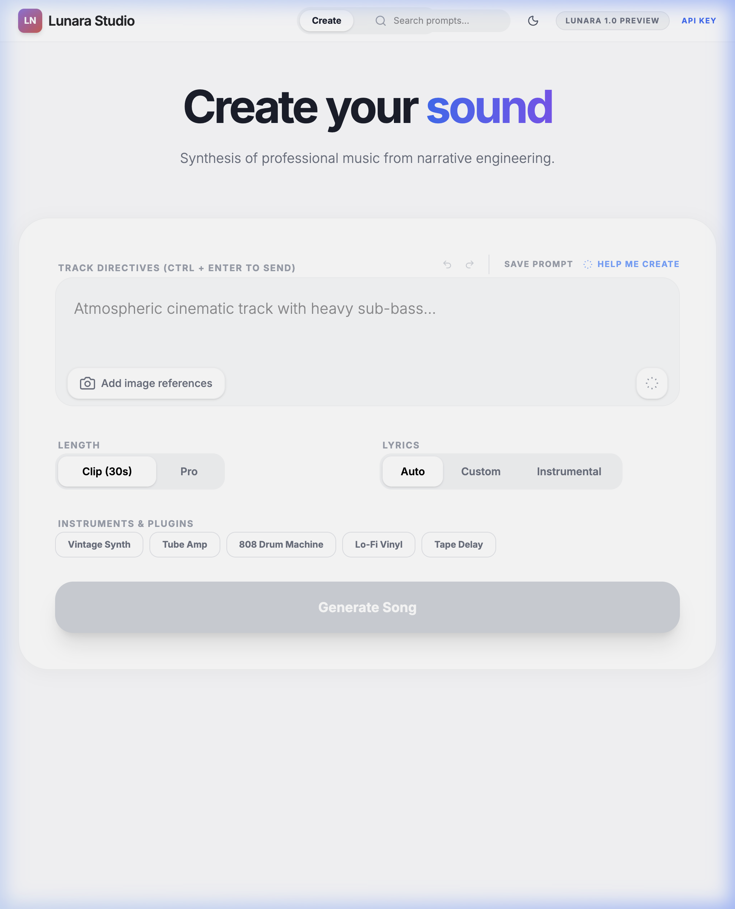
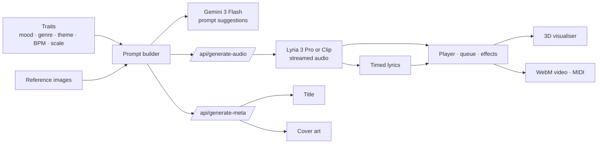
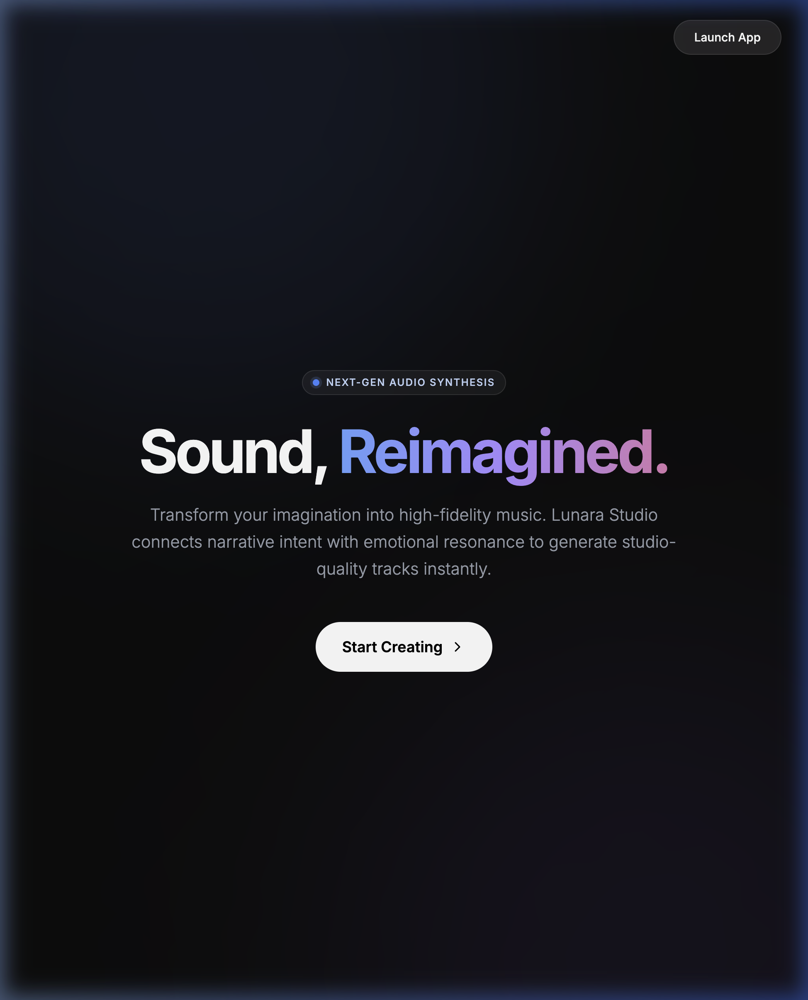
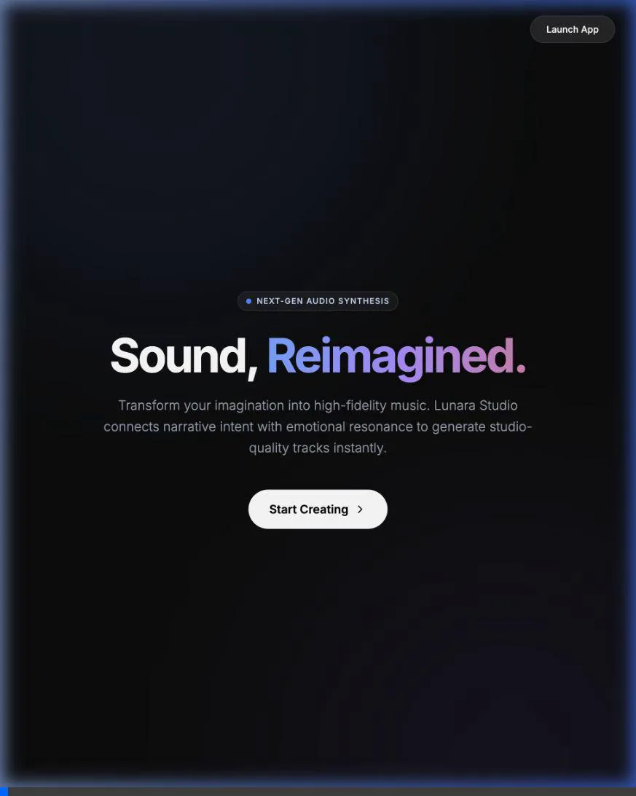

<div align="center">



<p>
  <a href="https://lunara-studio-liard.vercel.app/"></a>
  
  
  
</p>

<p><em>A prompt engineer, player and visualiser for AI music generation.<br>
Build the perfect prompt, hear the result, watch it move and export it as video or MIDI.</em></p>

<a href="https://lunara-studio-liard.vercel.app/"></a>

</div>


## What it is

Writing a good prompt for an audio model is chaotic. Lunara turns it into a structured builder with moods, genres, themes, BPM and scales, suggests prompts with Gemini, and keeps your history with undo and redo. Prompts, history and settings stay in your browser.

| | |
|---|---|
| **Prompt builder** | Moods, genres, themes, BPM and scales in one structured form. |
| **AI suggestions** | Gemini proposes the strongest prompt for the traits you picked. |
| **Visual context** | Attach reference images alongside the prompt. |
| **Play queue** | Queue, reorder and play generated tracks back to back. |
| **3D visualiser** | A React Three Fiber sphere that follows the rhythm and tempo. |
| **Video export** | Record waveform, bars or particle visuals as WebM. |
| **MIDI download** | Get the chord sheet as a `.mid` file for your DAW. |
| **History** | Unlimited undo / redo with local autosave. |
| **Two lengths** | *Pro* asks Lyria 3 Pro for a full track; *Clip* asks Lyria 3 Clip for a short one. Audio streams back and plays as it arrives. |
| **Title, cover and lyrics** | Gemini names the song and an image model paints a cover. Lyrics come back with the audio, are parsed into timed lines and highlight with playback. |
| **Studio effects** | Real-time Web Audio plugins on playback: chorus, delay, distortion, a low-pass filter and vinyl crackle. |
| **Community** | A community area behind Google sign-in (early). |


## From traits to a track



Keys stay on the server: the browser talks to two small API routes, never to the models directly.

<table>
  <tr>
    <td width="50%"></td>
    <td width="50%"></td>
  </tr>
  <tr>
    <td align="center"><code>landing</code></td>
    <td align="center"><code>studio</code> · in motion</td>
  </tr>
</table>


## Türkçe özet

**Lunara Studio**, yapay zekâ ile müzik üretim sürecini kolaylaştıran bir prompt oluşturucu ve görselleştirme platformu. Ruh hali, tür, tema, BPM ve gam seçerek yapılandırılmış bir yönerge kuruyor, Gemini'den öneri alıyor, üretilen parçaları sıraya alıp dinliyorsun. Çalan müziğe tepki veren 3B görselleştirici var; sonuçlar WebM video ya da MIDI olarak indirilebiliyor. Tüm veriler tarayıcıda kalıyor.


## Development

```sh
npm install
cp .env.example .env.local   # GEMINI_API_KEY
npm run dev                  # http://localhost:5173
npm run build
npm run lint                 # tsc --noEmit
```

```
App.tsx            studio: builder, player, queue, generation
src/components/    prompt builder, 3D visualiser, community feed
src/services/      Gemini helpers: suggestions, title, cover, output parsing
src/utils/         audio effects, timed lyrics, MIDI export, logging
api/               generate-audio (Lyria) and generate-meta (suggestions, title, cover)
```

<div align="center">
<br>
<a href="https://github.com/kutluhangil"></a>
<sub>Under the moon, every prompt finds its melody. · the track in the banner is invented.</sub>
</div>
